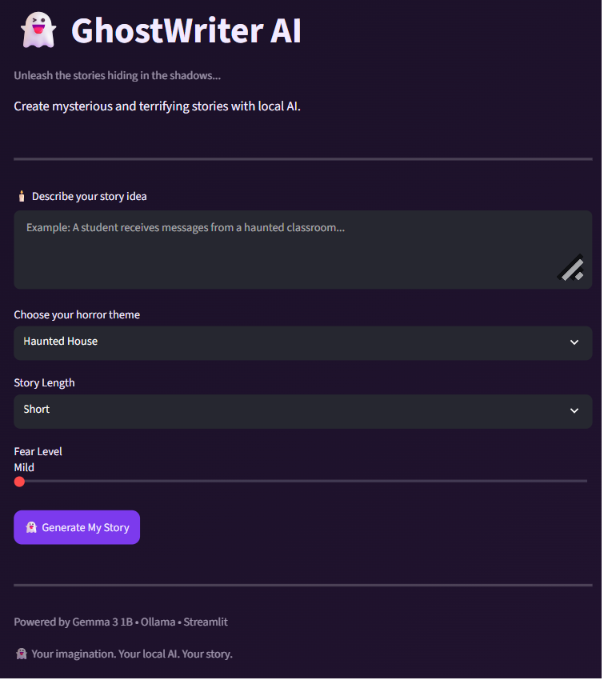
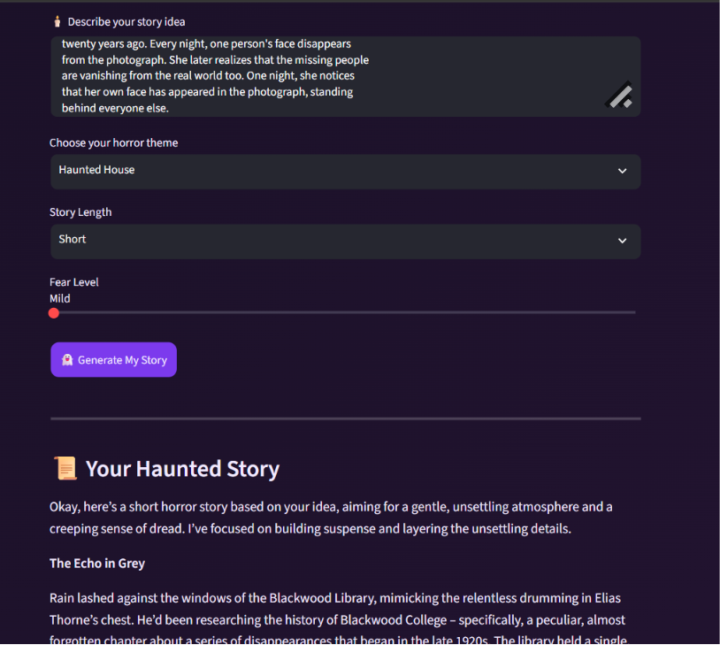

# 👻 GhostWriter AI

### Unleash the Stories Hiding in the Shadows

GhostWriter AI is a local AI-powered horror story generator that creates unique, mysterious and terrifying stories using Google's Gemma 3 1B model through Ollama.

## ✨ Features

- Generate original horror stories from custom prompts.
- Multiple horror themes.
- Adjustable story length.
- Customizable fear levels.
- Download generated stories as TXT files.
- Local AI inference using Ollama.
- No external AI API required.

## 🛠️ Tech Stack

- Python
- Streamlit
- Ollama
- Gemma 3 1B

## 📸 Screenshots

### Application Interface


### Generated Horror Story


## 🚀 Installation and Setup

### 1. Clone the repository

```bash
git clone YOUR_GITHUB_REPOSITORY_URL
cd GhostWriter-AI
```

### 2. Create a virtual environment

```bash
python -m venv venv
```

### 3. Activate the environment

Windows:

```bash
venv\Scripts\activate
```

### 4. Install dependencies

```bash
pip install -r requirements.txt
```

### 5. Install the AI model

Install Ollama from https://ollama.com/

Then run:

```bash
ollama pull gemma3:1b
```

### 6. Run the application

```bash
python -m streamlit run app.py
```

Open http://localhost:8501 in your browser.

## 🌍 Why Open Innovation Matters

GhostWriter AI uses the open-weight Gemma 3 1B model through Ollama for local inference.

This approach offers:

- More control over the AI model.
- No dependency on a paid external AI API.
- Better privacy for user prompts.
- Flexibility to experiment with different compatible models.
- An accessible way to explore generative AI locally.

## 🎃 The Spirit of the Project

Inspired by the Ghost in the Machine theme, GhostWriter AI brings spooky storytelling to life through locally running AI.

It transforms simple ideas into mysterious tales while keeping the AI experience on the user's own machine.

## 👩‍💻 Built With

Python | Streamlit | Ollama | Gemma 3 1B

---

**Your imagination. Your local AI. Your story. 👻**
